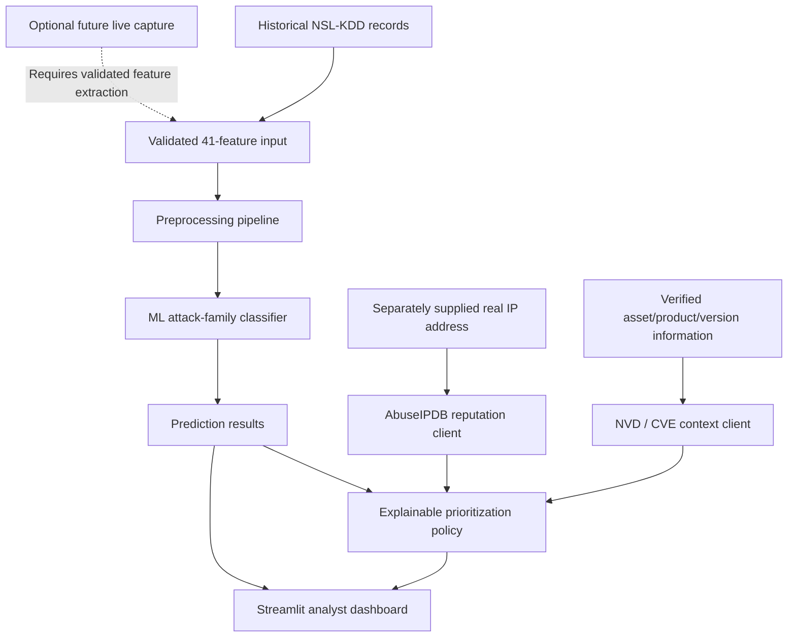

<div align="center">

# 🛡️ SentinelNet AI

### Real-Time Network Intrusion & Threat Risk Scoring

**A Data Science graduation project developed as part of the Digital Egypt Pioneers Initiative (DEPI).**

*Network-traffic classification • Threat intelligence • Explainable risk prioritization*


</div>

---

## 📖 Overview

**SentinelNet** is a machine-learning-based network intrusion detection and security analysis project. Its goal is to help security analysts distinguish benign network connections from suspicious behavior, understand the likely attack category, and prioritize investigation using relevant supporting evidence.

The **planned system** combines:

1. **Multiclass traffic classification:** Predict one of five categories — `Normal`, `DoS`, `Probe`, `R2L`, or `U2R`.
2. **IP reputation enrichment:** Look up *separately supplied, valid* IP addresses using AbuseIPDB.
3. **Vulnerability context:** Retrieve relevant CVE/NVD information when an identifiable asset, product, and version are available.
4. **Explainable prioritization:** Provide documented reasons for an analyst-facing threat priority.
5. **Interactive dashboard:** Present classifications, context, and investigation results using Streamlit.

> [!IMPORTANT]
> **Current status:** SentinelNet is in the **data-understanding / preparation stage**. The repository assessment confirmed dataset loading, initial exploratory analysis, attack-family mapping, feature/target separation, and labeled CSV exports. **There is no trained model, operational threat-intelligence integration, risk engine, dashboard, or validated real-time traffic capture yet.** The components above describe the project vision, not completed functionality.

## 🎯 Problem Statement

Networks produce large volumes of connection activity. Manually reviewing every connection is impractical, while basic detection signals can be difficult to interpret or prioritize.

SentinelNet aims to support analysts by answering three distinct questions:

- **What kind of activity does this connection resemble?** → ML classification.
- **What other relevant evidence is available?** → Reputation and vulnerability context, when inputs support those lookups.
- **Which findings deserve attention first, and why?** → Explainable prioritization.

SentinelNet is intended as a **decision-support / intrusion-detection project**, not an intrusion-prevention system that automatically blocks traffic.

## 🧠 Machine Learning Task

SentinelNet uses **supervised, five-class classification** with the target column `attack_type`.

| Class | Description |
| --- | --- |
| **Normal** | Benign network connection activity |
| **DoS** | Denial-of-service activity intended to disrupt service availability |
| **Probe** | Scanning and reconnaissance activity |
| **R2L** | Unauthorized remote-to-local access attempts |
| **U2R** | Attempts to escalate user privileges to root/administrative privileges |

### Dataset: NSL-KDD

The initial dataset is [NSL-KDD](https://www.unb.ca/cic/datasets/nsl.html), a **historical benchmark**, not a collection of modern live network packets.

| Split | File | Records |
| --- | --- | ---: |
| Training | `KDDTrain+.txt` | 125,973 |
| Testing | `KDDTest+.txt` | 22,544 |
| **Total** | | **148,517** |

Each raw row contains **43 columns**: **41 network-traffic features**, an original attack-name `label`, and `difficulty` metadata. The initial notebook adds `attack_type`, bringing the labeled output to **44 columns**.

The 41 approved ML inputs include:

- **3 categorical features:** `protocol_type`, `service`, `flag`
- **38 numeric features:** durations, byte counts, connection statistics, rates, indicators, and related measurements

**Do not use `label`, `difficulty`, or `attack_type` as model inputs.** In particular, the original `label` reveals the attack identity and would create target leakage.

### Verified Class Distribution

| Attack family | Train | Test |
| --- | ---: | ---: |
| Normal | 67,343 | 9,711 |
| DoS | 45,927 | 7,460 |
| Probe | 11,656 | 2,421 |
| R2L | 995 | 2,885 |
| U2R | 52 | 67 |

**Class imbalance is a major challenge.** U2R accounts for only around **0.041%** of the training records, so overall accuracy by itself will not be an adequate success metric.

### Intended Evaluation Strategy

The model development stage will aim to:

- Keep the supplied **test split reserved for final evaluation**.
- Create validation splits or cross-validation **within the training split**.
- Fit encoders, scalers, selectors, and any resampling **only on the appropriate training folds**.
- Compare a dummy baseline, a suitable linear model, and tree-based models before selecting a final estimator.
- Report **per-class precision, recall, F1, support, macro F1, confusion matrices, and false-positive behavior**.
- Investigate minority-class failure cases rather than optimizing headline accuracy alone.
- Save the preprocessing steps **together with the selected estimator** to preserve consistency during inference.

**No model performance claims are available yet.**

## 🏗️ Proposed System Architecture

The diagram below illustrates the **intended architecture**, not a fully implemented runtime.



**Key design principle:** ML classification, external intelligence, prioritization, and UI presentation should be modular. Missing or failed external lookups should be represented as *unavailable*, not silently interpreted as safe.

## ✅ Development Status

This table reflects the **November 2026 Codex repository assessment snapshot**. Refer to newer commits and tests for any subsequent changes.

| Work item | Status |
| --- | --- |
| Initial repository structure and project documentation | ✅ Initial setup complete |
| Raw NSL-KDD dataset collection | ✅ Complete |
| Data loading and initial EDA | ✅ Implemented in notebook |
| Basic quality checks and attack-family mapping | ✅ Initial implementation complete |
| Feature/target separation and labeled CSV export | ✅ Complete |
| Reusable data-loading/validation Python modules | ⬜ Not implemented |
| Leakage-safe preprocessing pipeline | ⬜ Not implemented |
| Trained classifiers and model comparison | ⬜ Not implemented |
| Evaluation reports and saved model artifacts | ⬜ Not implemented |
| Single/batch prediction interface | ⬜ Not implemented |
| AbuseIPDB and NVD/CVE integrations | ⬜ Not implemented |
| Explainable risk-priority engine | ⬜ Not implemented |
| Streamlit dashboard | ⬜ Not implemented |
| Live packet capture and validated feature extraction | ⬜ Not implemented |
| Deployment and automated end-to-end tests | ⬜ Not implemented |

### Immediate Next Milestone

**Create a reproducible data-loading and validation layer**, then build a leakage-safe preprocessing and model-training pipeline. Before committing to advanced features, confirm the official DEPI deliverables and whether actual live traffic detection is required.

## 🗂️ Repository Layout

> [!NOTE]
> The repository currently contains a **double-nested project directory**. The structure below reflects the assessed layout; many folders still contain only `.gitkeep` placeholders.

```text
SentinelNet-AI/
├── PROJECT_IDEAS.md
├── README.md                         # This repository overview (add at top level)
└── sentinelnet-network-intrusion-detection-main/
    └── sentinelnet-network-intrusion-detection-main/
        ├── config/
        ├── dashboard/
        ├── data/
        │   ├── raw/
        │   │   ├── KDDTrain+.txt
        │   │   └── KDDTest+.txt
        │   └── processed/
        │       ├── train_labeled.csv
        │       └── test_labeled.csv
        ├── models/
        ├── notebooks/
        │   └── 01_Data_Collection_and_Understanding.ipynb
        ├── reports/
        ├── src/
        │   ├── api/
        │   ├── data/
        │   ├── features/
        │   ├── models/
        │   └── scraping/
        ├── .gitignore
        ├── README.md
        └── requirements.txt
```

At the assessed stopping point, most completed logic is in the data-understanding notebook; folders alone do not indicate working components.

## 🚀 Getting Started — Current Notebook

These are **initial setup instructions**, not a verified one-command installation or launch of a completed application. The assessed environment had unpinned dependencies, inconsistent notebook path assumptions, and packages missing from the checked Python interpreter.

### Prerequisites

- Git
- Python and `pip` (choose a compatible version after checking the dependencies; a supported version is **not yet pinned**)
- A virtual environment
- Jupyter Notebook

### 1. Clone and open the nested project

```bash
git clone https://github.com/mina297/SentinelNet-AI.git
cd SentinelNet-AI/sentinelnet-network-intrusion-detection-main/sentinelnet-network-intrusion-detection-main
```

### 2. Create a virtual environment

**Windows PowerShell:**

```powershell
python -m venv .venv
.\.venv\Scripts\Activate.ps1
```

**macOS / Linux:**

```bash
python3 -m venv .venv
source .venv/bin/activate
```

### 3. Install declared dependencies

```bash
python -m pip install -r requirements.txt
```

> [!WARNING]
> Dependency versions are currently unpinned. The assessment found that the checked Python 3.14 environment lacked several required packages. Compatibility and reproducibility should be verified before interpreting installation or notebook results as successfully reproduced.

### 4. Explore the data-understanding notebook

The current notebook uses `Path.cwd().parent` when resolving the project root. **For the existing code, launch Jupyter from the `notebooks/` directory** so the parent path points to the project directory:

```bash
cd notebooks
jupyter notebook
```

Open `01_Data_Collection_and_Understanding.ipynb` in the browser. Inspect the cells before running them: some cells write processed CSV files.

**Current output:** labeled training and testing datasets in `data/processed/`. These outputs are **not** fully encoded, scaled, or model-ready feature matrices.

## 🔌 Planned Threat-Intelligence Integrations

### AbuseIPDB

[AbuseIPDB](https://www.abuseipdb.com/) can supply IP-reputation evidence for a **real, externally supplied** address. NSL-KDD has **no actual source/destination IP columns**, so IP addresses must not be invented or attributed to the dataset.

A future client should support secure credentials via environment variables, IP validation, timeouts, rate-limit handling, caching, provenance, and explicit unknown/error states.

### NVD / CVE

The [National Vulnerability Database](https://nvd.nist.gov/) provides vulnerability context. A connection's service label alone (for example, `http`) does **not** establish a vulnerable product/version. CVE context should be associated with an asset only when there is defensible identity, product/version, or configuration evidence.

Both integrations are **planned and untested**, not available project features.

## ⚠️ Technical Scope and Limitations

- **Historical benchmark:** Results on NSL-KDD alone do not prove effectiveness on modern production networks.
- **Not live capture:** Processing stored records or replaying them is not the same as capturing live network traffic.
- **Feature compatibility:** Receiving an IP address or packet is insufficient to reconstruct all 41 NSL-KDD features. A live extractor must be explicitly designed and validated.
- **Unseen attack names:** The test split contains attack names absent from training; classification into known families is **not** proof of open-set or zero-day detection.
- **Rare attacks:** With only 52 U2R training records, minority-class results will need particular care.
- **Data overlap:** Limited identical 41-feature vectors occur within or across splits; these observations require documentation and sensitivity analysis, not silent deletion or alteration of the supplied official split.
- **Risk semantics:** A future investigation-priority score must not be presented as a calibrated probability of an attack unless it has been evaluated as such.
- **Not production-ready:** SentinelNet is an educational/research project under development and should not be relied on as a production security control.

## 🛣️ Roadmap

- [x] Set up initial project structure
- [x] Collect and inspect NSL-KDD training/testing files
- [x] Map attack names into five target families
- [x] Export labeled data and separate model inputs/targets
- [ ] Confirm official DEPI requirements and deployment/real-time expectations
- [ ] Reproduce environment and implement reusable input/data validation
- [ ] Build safe feature encoding and preprocessing
- [ ] Compare baseline models using training-only validation
- [ ] Evaluate class imbalance and finalize test-set evaluation
- [ ] Persist model, preprocessing, and metadata
- [ ] Provide validated single/batch inference
- [ ] Add independently tested AbuseIPDB and NVD clients
- [ ] Define and test explainable prioritization rules
- [ ] Develop the Streamlit dashboard
- [ ] Integrate, test, document, and deploy the agreed system
- [ ] Evaluate real-time feature extraction **if required and feasible**

## 👥 Team Workstreams

The team plans to divide the remaining work across **four approximately equal areas of responsibility**:

| Workstream | Ownership |
| --- | --- |
| **Data Engineering & QA** | Schema, reproducibility, reusable validation, integration tests |
| **Machine Learning Engineering** | Preprocessing, classifiers, rare-class analysis, evaluation, model artifacts |
| **Threat Intelligence & Risk** | AbuseIPDB, CVE/NVD context, documented prioritization policy |
| **Dashboard & Application** | Streamlit interface, prediction workflow integration, demo and deployment |

Work can proceed in parallel **once the data schema and component interfaces are agreed**. Final UI integration depends on a working prediction function, while external intelligence can be built independently with clearly identified mocked responses.

> Team member names and assignments can be added once the responsibilities are confirmed.

## 🤝 Contributing

For team development:

1. Create a feature branch from `main` (for example, `feature/ml-pipeline` or `feature/dashboard`).
2. Keep changes focused and include tests/documentation for new behavior.
3. Open a pull request explaining what changed and how it was verified.
4. Do not commit credentials or secret `.env` files.
5. Do not claim integrations or performance metrics work until they have been tested.
6. Keep the original NSL-KDD train/test split unchanged for the final evaluation.

## 📚 References

- [NSL-KDD — University of New Brunswick](https://www.unb.ca/cic/datasets/nsl.html)
- [Original KDD Cup 1999 feature descriptions](https://kdd.ics.uci.edu/databases/kddcup99/task.html)
- [NSL-KDD dataset listing on Kaggle](https://www.kaggle.com/datasets/hassan06/nslkdd)
- [scikit-learn: Common pitfalls and data leakage](https://scikit-learn.org/stable/common_pitfalls.html)
- [AbuseIPDB API documentation](https://docs.abuseipdb.com/)
- [National Vulnerability Database](https://nvd.nist.gov/)
- [Streamlit documentation](https://docs.streamlit.io/)

---

<div align="center">

**SentinelNet AI** · *Classify threats. Enrich context. Prioritize investigation.*

*Developed as a Data Science graduation project for DEPI.*

</div>
