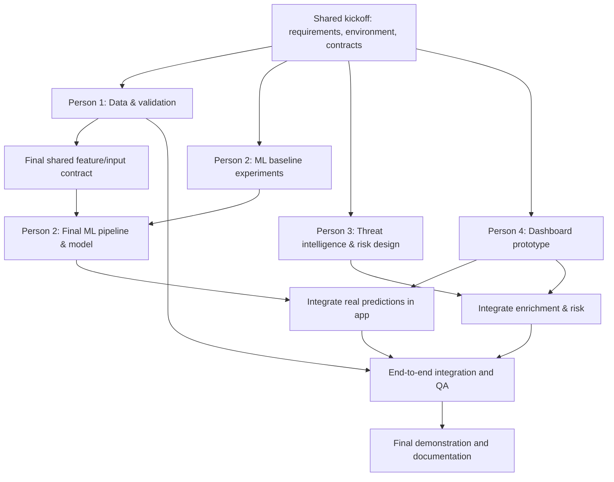

# SentinelNet — Team Work Distribution & Development Plan

> **Project:** SentinelNet — Real-Time Network Intrusion & Threat Risk Scoring  
> **Program:** Digital Egypt Pioneers Initiative (DEPI) — Data Science Graduation Project  
> **Team size:** 4 members  
> **Document type:** Proposed responsibility allocation, dependency plan, and execution roadmap  
> **Status:** Proposal for team discussion; not a record of work already implemented

---

## 1. Executive Summary

SentinelNet aims to classify network connections as **Normal, DoS, Probe, R2L, or U2R** using machine learning, then add separate **IP reputation intelligence (AbuseIPDB)**, **vulnerability context (NVD/CVE)**, **explainable investigation prioritization**, and a **Streamlit dashboard**.

**Recommended approach:** Split the remaining work across **four major technical workstreams** so all four members can begin together **after a short shared planning and interface-design session**. Parallel development is possible, but full integration has dependencies.

| Person | Primary ownership | Target share of team workload |
|---|---|---:|
| **Person 1** | Data Engineering, Validation & Quality Assurance | 25% |
| **Person 2** | Machine Learning Engineering & Evaluation | 25% |
| **Person 3** | Threat Intelligence & Risk Prioritization | 25% |
| **Person 4** | Application, Dashboard & Deployment | 25% |

**Important:** These percentages are **equal targets**, *not measured effort*. Work hours may differ in individual weeks. Track actual effort and rebalance independent testing, documentation, and integration tasks as needed.

### Key answer: Sequential or parallel?

- **Parallel:** Data validation, initial ML experimentation, independent API clients, risk-policy design, and a dashboard prototype can begin simultaneously once shared interfaces are agreed.
- **Sequential dependencies:** Final ML training code needs a reliable feature contract; real dashboard predictions need a trained, saved model and prediction function; end-to-end QA needs the components integrated.
- **Not decided:** Whether actual live packet capture is required. Do **not** present historical-record replay or new-record prediction as verified live detection.

---

## 2. Current Project Baseline (From the Codex Assessment Snapshot)

The following is the **reported state at the time of the supplied assessment**, not a new audit of the current repository.

### 2.1 Completed initial work

- [x] Initial project folder structure.
- [x] NSL-KDD raw dataset collection (`KDDTrain+.txt`, `KDDTest+.txt`).
- [x] Notebook-based loading and initial exploratory data analysis (EDA).
- [x] Initial data-quality checks (missing values, duplicates, consistency).
- [x] Mapping specific attack labels to five target families.
- [x] Feature/target separation with the 41 approved model features.
- [x] Export of labeled CSV files (`train_labeled.csv`, `test_labeled.csv`).

The implementation is mainly in `notebooks/01_Data_Collection_and_Understanding.ipynb`.

### 2.2 Not yet implemented in the assessment

- [ ] Reusable data-loading/validation Python modules and automated tests.
- [ ] Leakage-safe encoding/scaling and training pipeline.
- [ ] Model selection, imbalance experiments, evaluation, saved artifacts.
- [ ] Prediction interface for single and batch records.
- [ ] AbuseIPDB client and verified external integration.
- [ ] NVD/CVE context integration.
- [ ] Explainable risk-prioritization policy.
- [ ] Streamlit dashboard.
- [ ] Actual live traffic capture or validated live feature extraction.
- [ ] Deployment and complete operational documentation.

**Data constraints to preserve:**

- NSL-KDD has **41 model input features**: 3 categorical (`protocol_type`, `service`, `flag`) and 38 numeric.
- Exclude `label`, `difficulty`, and `attack_type` from model input to avoid leakage.
- Preserve the supplied training/test split; choose validation strategies using **training data only**.
- The training set has **52 U2R records**: minority-class metrics matter; accuracy alone is insufficient.
- NSL-KDD does **not** contain real source/destination IP addresses. Any IP enrichment must use separately supplied, valid IP metadata.
- Do not infer vulnerability applicability from a service name alone; use justified asset/product/version context.

---

## 3. Person 1 — Data Engineering, Validation & Quality Assurance

**Mission:** Make the dataset and project environment reliable, reproducible, and safe for other modules to consume.

### Responsibilities

1. **Environment and repository consistency**
   - Confirm the canonical project root (the assessment found a nested repository path).
   - Establish a supported Python version and reproducible dependency setup.
   - Document installation and run instructions.
   - Help establish the shared repo conventions and CI workflow.
2. **Reusable data layer**
   - Convert essential notebook loading logic into reusable Python functions/modules.
   - Use explicit feature names and schema rather than relying on fragile paths or implicit column selection.
   - Preserve original data and official train/test boundaries.
3. **Validation and safeguards**
   - Validate expected schema, types, required values, and label mapping coverage.
   - Explicitly allowlist the 41 model input columns.
   - Fail clearly on malformed records or incorrect column layouts.
   - Document dataset quality issues and cross-split overlaps without silently editing the official split.
4. **Automated quality assurance**
   - Unit-test loading, mapping, feature selection, and malformed-input behavior.
   - Create reusable test fixtures where appropriate.
   - Coordinate integration checks and reproducibility checks across the team.
5. **Documentation and handoff**
   - Write the data contract used by Persons 2 and 4.
   - Document how input records should be validated for inference.

### Expected deliverables

- [ ] Reproducible Python environment/setup instructions.
- [ ] Tested data loading and validation module(s).
- [ ] Explicit 41-feature contract and dataset mapping documentation.
- [ ] Automated tests and shared CI checks (if practical).
- [ ] Data-quality findings and instructions for consumers of the data layer.

### Dependency notes

Person 1 can start immediately using existing raw and labeled files. Person 2 can experiment in parallel, but should adopt Person 1's validated data contract in the final pipeline. Person 4 needs the input validation/interface contract for real-record submission.

---

## 4. Person 2 — Machine Learning Engineering & Evaluation

**Mission:** Build a scientifically defensible five-class intrusion-detection model and a reusable prediction interface.

### Responsibilities

1. **Preprocessing pipeline**
   - Encode the three categorical fields with a documented unknown-category policy.
   - Apply numeric transformations/scaling only where the estimator benefits.
   - Keep preprocessing and estimator within a reusable pipeline.
2. **Validation strategy**
   - Split or cross-validate **within the training set only**.
   - Fit encoders, scalers, feature selectors, and any resampling on training folds, not held-out data.
   - Keep the supplied `KDDTest+` data for final evaluation.
3. **Model experiments**
   - Establish a dummy baseline.
   - Compare an interpretable linear model and suitable tree-based candidates (e.g., Random Forest or XGBoost).
   - Track configurations, metrics, and random seeds.
4. **Class-imbalance research**
   - Prioritize minority class performance (especially R2L and U2R).
   - Try justified class weighting before blindly applying synthetic resampling.
   - Document tradeoffs, false positives, and class-specific failure cases.
5. **Evaluation and delivery**
   - Report per-class precision, recall, F1, support; macro F1; confusion matrix; and normal-class false positive behavior.
   - Perform final testing without tuning on the test split.
   - Save the chosen preprocessing+model pipeline and metadata.
   - Provide a predictable prediction function/API contract supporting valid records.

### Expected deliverables

- [ ] Leakage-safe preprocessing and training pipeline.
- [ ] Baseline and model-comparison results.
- [ ] Minority-class analysis and documented evaluation.
- [ ] Final selected model artifact, metadata, and reproducible training procedure.
- [ ] Working prediction interface for application integration.

### Dependency notes

Person 2 can start baseline experiments using existing labeled CSVs and agreed approved features. Final shared code should wait for/align with Person 1's validated schema. Person 4 can build against an agreed **mock** prediction result until real inference is available.

---

## 5. Person 3 — Threat Intelligence & Risk Prioritization

**Mission:** Add independently testable external cybersecurity evidence and an explainable investigation-priority policy.

### Responsibilities

1. **AbuseIPDB component**
   - Build an IP lookup client using **independently supplied IP addresses**.
   - Validate IP values; define handling for non-public/private IPs.
   - Manage credentials via environment variables and avoid committing secrets.
   - Handle API timeouts, rate limits, failures, stale data, caching, and unknown results.
2. **NVD/CVE component**
   - Use a documented official data source/API where appropriate.
   - Return vulnerability context only when linked to justified asset, product/version, or applicability evidence.
   - Record evidence source, retrieval time, and unavailable states.
   - Do not map generic NSL-KDD `service` values directly to specific CVEs.
3. **Risk prioritization**
   - Agree on the meaning of priority (e.g., analyst investigation priority).
   - Define an explainable, versioned policy using applicable signals.
   - Keep model probabilities, IP reputation, CVSS, and asset criticality conceptually distinct.
   - Explicitly handle missing/conflicting evidence; failed lookups must not mean zero risk.
4. **Tests and integration**
   - Use clear mocks for unit tests; distinguish them from verified live API calls.
   - Agree with Person 4 on standardized evidence/priority outputs.
   - Test abnormal input, error conditions, and explanation accuracy.

### Expected deliverables

- [ ] AbuseIPDB lookup module with tests and documented error handling.
- [ ] NVD/CVE context module with evidence/applicability safeguards.
- [ ] Documented and tested explainable prioritization policy.
- [ ] Clear interface contracts for evidence, failure states, and priority reasons.
- [ ] Verified integration results where credentials/requirements permit; mocks labeled as such.

### Dependency notes

Person 3 can begin API design, client implementation, contract design, and isolated tests independently of ML. The risk-policy logic can be prototyped using clearly labeled sample model outputs, but final integrated behavior depends on the real prediction contract and relevant metadata.

---

## 6. Person 4 — Application, Dashboard & Deployment

**Mission:** Assemble the components into a usable analyst-facing application and demonstration.

### Responsibilities

1. **Streamlit dashboard**
   - Design input forms for compatible feature records and batch upload.
   - Show classifications, distributions, filtered tables, and investigation details.
   - Display enrichment evidence and explainable risk priorities.
   - Distinguish unknown/unavailable API results from negative evidence.
2. **Prediction workflows**
   - Establish a shared input/output contract with Persons 1 and 2.
   - Prototype UI flow against clearly labeled **mock data**, not fabricated production metrics.
   - Connect actual inference when the saved ML pipeline is available.
3. **Integration**
   - Connect the shared ML prediction function.
   - Connect Person 3's separate intelligence and risk modules.
   - Provide friendly validation errors and failure behavior.
   - Avoid duplicating domain logic inside the dashboard code.
4. **Deployment and demonstration**
   - Prepare run instructions and configuration management.
   - Test end-to-end examples and dashboard behavior.
   - Create a reproducible final demonstration using available supported inputs.
   - Clearly label historical replay versus live detection.

### Expected deliverables

- [ ] Streamlit dashboard prototype.
- [ ] Working single-record and batch workflows against real application logic.
- [ ] Integrated results display for classification, intelligence, and priority.
- [ ] Error handling and user experience checks.
- [ ] Deployment/run instructions and reproducible end-to-end demo.

### Dependency notes

Person 4 can start layout, forms, mock adapter, and charts immediately after output formats are agreed. **Real inference integration** requires Person 2's trained pipeline. **Threat-priority presentation** requires Person 3's module. Person 1's validation contract governs accepted records.

---

## 7. Parallel Work vs. Dependencies

### 7.1 What can start in parallel?

| Work | Owner | Start after shared contracts? | Notes |
|---|---|---|---|
| Repository/environment consistency | Person 1 | **Yes** | Establish reproducible setup early. |
| Data loader/schema validation | Person 1 | **Yes** | Use known dataset schema. |
| Initial model experiments | Person 2 | **Yes** | Existing labeled data are available; preserve feature allowlist and holdout. |
| AbuseIPDB client and mocked tests | Person 3 | **Yes** | Live tests depend on valid credentials and IP input. |
| NVD client and contextual design | Person 3 | **Yes** | Real CVE matching needs applicable asset metadata. |
| Risk-scoring design | Person 3 | **Yes** | Need agreed semantics and output fields. |
| Streamlit layout/prototype | Person 4 | **Yes** | Use clearly labeled mocks until real outputs exist. |
| Input/error UX design | Person 4 | **Yes** | Align with Person 1's schema. |

### 7.2 What must wait for another deliverable?

| Downstream task | Required upstream work | Owners involved |
|---|---|---|
| Final reproducible ML pipeline | Data feature contract and validated loading | Persons 1 → 2 |
| Real single/batch classification in dashboard | Saved model and prediction interface | Persons 2 → 4 |
| Enrichment/priority in application | Threat-intelligence and risk interfaces | Persons 3 → 4 |
| End-to-end behavior and reliability tests | Integrated working components | All four |
| Production-like live network detection | Scope decision and validated feature-extraction design | All four; additional work likely |

### 7.3 Dependency diagram

**Critical path:** Reliable input/data contract → final ML pipeline and prediction interface → actual dashboard inference → integrated QA/demo. Threat intelligence and the dashboard prototype should proceed alongside this path.

---

## 8. Proposed Sprint Roadmap

> These are **milestone-based sprints**, not fixed calendar dates. Assign durations only after confirming the DEPI deadline and team availability.

| Sprint | Person 1 — Data & QA | Person 2 — ML | Person 3 — Intelligence & Risk | Person 4 — Application |
|---|---|---|---|---|
| **Sprint 0: Team kickoff** | Agree project root, environment, feature/schema contract | Define ML candidates and evaluation metrics | Define required metadata, API response contracts, and failure states | Define dashboard requirements and prediction result format |
| **Sprint 1: Parallel foundations** | Reusable data validation, unit tests | Preprocessing + initial baselines | API clients + isolated/mock tests | Streamlit structure + mock-data prototype |
| **Sprint 2: Core development** | Input checks, CI, integration tests | Model comparison, imbalance analysis, holdout evaluation, artifact export | Risk policy, evidence provenance, robustness tests | File upload, single/batch workflows, charts and filtering |
| **Sprint 3: Integration** | System QA, reproducibility and documentation | Connect real prediction interface; debug inference issues | Connect enrichment, risk and explanations | Integrate modules, deployment/run setup and demo |

### Sprint 0: Joint decisions before coding

All four members should jointly confirm:

- [ ] Official DEPI assessment rubric and deadline.
- [ ] Whether scraping, external APIs, dashboard, deployment, and **actual live capture** are mandatory.
- [ ] Repository naming, folder ownership, branching and review rules.
- [ ] Supported Python version and dependency strategy.
- [ ] The exact 41-feature schema and strict excluded columns.
- [ ] Prediction input/output interface and how missing information is represented.
- [ ] Enrichment, priority, and explanation output formats.
- [ ] How the team will distinguish historical records, replay, mock data, and live activity.

**Avoid waiting for a complete ML model to begin UI or API work.** Only the final connection to real predictions needs the finished model.

---

## 9. Shared Interface Contracts (Agree Before Parallel Coding)

These are **design questions to resolve**, not implemented APIs.

### 9.1 Data/feature contract

Agree on:

- Exact ordered feature names and accepted data types.
- Single-record and batch input shape.
- Required vs. optional fields and validation errors.
- Whether separately supplied `source_ip`, `asset_id`, and software metadata are supported (outside the 41 ML features).
- Data provenance indicators: historical benchmark, replay, externally supplied feature record, mock, or validated live source.

### 9.2 Prediction result contract

Agree on:

- Predicted attack class (`Normal`, `DoS`, `Probe`, `R2L`, `U2R`).
- Optional class probabilities/scores when the selected model supports them.
- Model/pipeline version and relevant timestamps.
- Input validation failures and processing errors.
- Whether confidence is calibrated before treating it as a probability.

### 9.3 Threat-intelligence/priority contract

Agree on:

- Reputation lookup state: successful, unknown, unavailable, invalid, rate-limited, or error.
- Evidence fields, sources, retrieval times, and freshness.
- CVE applicability evidence rather than ungrounded guesses.
- Priority category or value **with an explanation** and policy version.
- Behavior when the ML prediction and external evidence disagree.

### 9.4 Dashboard contract

The UI must be able to show:

- Correct predictions from the real model once integrated.
- Validation and unavailable-evidence states.
- Clear differences between predicted class and investigation priority.
- The origin of records (historical, replay, mock, actual live if implemented).

---

## 10. GitHub Collaboration Plan

### Recommended branches

| Person | Example feature branch | Primary paths / modules |
|---|---|---|
| Person 1 | `feature/data-validation` | `src/data/`, related tests, shared checks |
| Person 2 | `feature/ml-pipeline` | `src/features/`, `src/models/`, experiment reports |
| Person 3 | `feature/threat-intelligence` | Intelligence/risk modules, integration tests |
| Person 4 | `feature/dashboard` | `dashboard/`, integration glue, deployment docs |

The example paths reflect **intended ownership**, not proof that those modules already exist.

### Workflow rules

1. Keep `main` stable; work on feature branches.
2. Agree interfaces before independently writing dependent components.
3. Open pull requests with a short summary, tests, and any assumptions.
4. Have at least one teammate review a pull request before merging when feasible.
5. Avoid unrelated changes inside another member's main ownership area without coordinating.
6. Use issues/tasks to track work, blockers, and dependencies.
7. Never commit API keys, `.env` secrets, or credentials.
8. Do not commit unnecessary large model artifacts or datasets unless the repository policy explicitly allows it.
9. Clearly label mocked data and external-response fixtures.
10. Re-run automated tests and a short integration smoke test after merges.

---

## 11. Keeping the Workload Fair

A 25% allocation should mean **roughly equal responsibility and effort over the project**, not identical file counts, lines of code, or weekly hours.

### Practical balancing method

- At each sprint kickoff, estimate tasks in **person-hours or relative effort points**.
- Each member should own **implementation + own tests + documentation** for their component.
- During weekly reviews, track completed tasks, blocked work, and remaining effort.
- Reassign **independent** tasks (documentation, test cases, data quality analysis, demo preparation) if one member has a much heavier workload.
- Reserve shared time for integration and end-to-end testing so Person 4 is **not** responsible for debugging all other modules.
- If data work finishes earlier, Person 1 should support reproducibility, cross-module tests, and system QA rather than becoming idle.
- If ML experiments take longer, other members can continue API reliability, dashboard UX, and integration harnesses.

### Fairness check at the end of each sprint

| Check | Question |
|---|---|
| Workload | Does one person have significantly more estimated remaining effort? |
| Dependencies | Is anyone blocked waiting for an interface or artifact? |
| Quality | Have owners included tests and documentation, not just code? |
| Integration | Is troubleshooting shared between the relevant component owners? |
| Demonstration | Can every member explain the whole system, not only their own module? |

---

## 12. Completion / Acceptance Checklist

These are proposed acceptance criteria for team planning.

### Data layer (Person 1)

- [ ] Reproducible setup works on a fresh supported environment.
- [ ] Loading/validation code correctly handles both official data splits.
- [ ] All 41 approved features are explicitly enforced; no target leakage.
- [ ] Malformed input fails predictably and is tested.
- [ ] Important data limitations and mapping conventions are documented.

### ML layer (Person 2)

- [ ] Preprocessing and model are saved together or consistently reproducible.
- [ ] Training-only validation avoids leakage.
- [ ] Models compared against a baseline.
- [ ] Per-class results, macro F1, confusion matrix, and false-positive behavior reported.
- [ ] Final holdout evaluated without using it for tuning.
- [ ] Real prediction function accepts the agreed valid input format.

### Intelligence and risk layer (Person 3)

- [ ] AbuseIPDB client validates real separately supplied IPs.
- [ ] Error/rate-limit/unknown cases tested and shown correctly.
- [ ] CVE context only asserted with grounded applicability evidence.
- [ ] Risk policy has explicit rationale, inputs, and version.
- [ ] Mock tests are distinguished from verified external API integration.

### Dashboard and application (Person 4)

- [ ] Interface supports agreed valid record inputs and batch mode.
- [ ] Real model output is shown when model integration is ready.
- [ ] Enrichment/priority data is displayed with explanations and missing states.
- [ ] No historical replay is mislabeled as actual live traffic capture.
- [ ] Application can be run and demonstrated from clear instructions.

### Whole team

- [ ] Components integrated and tested end-to-end.
- [ ] Results and limitations reported honestly.
- [ ] Project documentation and final presentation are consistent with actual functionality.
- [ ] Live detection claims are made only if live capture and compatible extraction were truly implemented and validated.

---

## 13. Scope Risks and Decisions

### Mandatory versus optional work

The **official DEPI rubric has not been supplied** in the assessment. The team must confirm whether the following are required:

- Actual live packet/flow capture versus record prediction or replay.
- External APIs and/or web scraping.
- Streamlit dashboard.
- Deployment.
- Minimum performance evidence and evaluation expectations.
- Final deadline and required documentation.

### Real-time work may substantially change the allocation

If **actual live intrusion detection** is mandatory, the team must add work for traffic capture, feature extraction, validation of compatibility with model inputs, processing/latency, and live testing. The initial four-way allocation should be revisited rather than placing this entire new workstream on Person 4.

### ML integrity risks

- Only 52 training samples belong to U2R; headline accuracy can be misleading.
- The official train/test splits must remain intact for final evaluation.
- The original NSL-KDD dataset is historical; model quality on it does not establish accuracy on modern real-world networks.
- The model should not be described as a proven zero-day or open-set detector.

### Enrichment integrity risks

- There are no actual IP addresses in NSL-KDD's 41 input features.
- A generic service name does not identify a vulnerable product/version.
- API failures must not be treated as proof of zero threat.
- Risk scores require meaning and documented policy, not arbitrary averaging of unrelated signal scales.

---

## 14. Immediate Action Plan

1. **Hold a joint kickoff** to review this distribution and assign names to Persons 1–4.
2. **Check the DEPI rubric and deadline** and resolve the live-versus-replay requirement.
3. **Agree interface contracts** for feature inputs, model outputs, external evidence, and risk explanations.
4. **Create four feature branches and task boards** with the ownership above.
5. **Start the four independent workstreams in parallel.**
6. **Set integration checkpoints** so every member publishes useful interfaces and tests early.
7. **Re-estimate and rebalance** after the first sprint using actual progress and blockers.

## 15. Final Assignment Summary

| Owner | Primary area | First deliverable | Final handoff |
|---|---|---|---|
| **Person 1** | Data Engineering, Validation & QA | Stable environment + explicit data contract | Tested, reproducible data/validation modules |
| **Person 2** | ML Engineering | Initial preprocessing + baseline experiment | Evaluated and saved classifier + prediction interface |
| **Person 3** | Threat Intelligence & Risk | API/risk contracts + independent tests | Enrichment clients + explainable priority output |
| **Person 4** | Application & Dashboard | Streamlit prototype with labeled mock outputs | Integrated usable app, demo, and deployment/run docs |

**Bottom line:** The team should **work in parallel**, but align early on interfaces and respect the core dependency: **validated data → final ML model → real dashboard predictions → end-to-end integration**. Threat intelligence and dashboard prototyping can proceed concurrently. Keep the work share equal through sprint-level rebalancing, not rigid task counts.

---

*Prepared from the SentinelNet Codex assessment snapshot and the four-person division discussion. This is a proposed execution plan, not confirmation that any remaining component has been implemented.*
